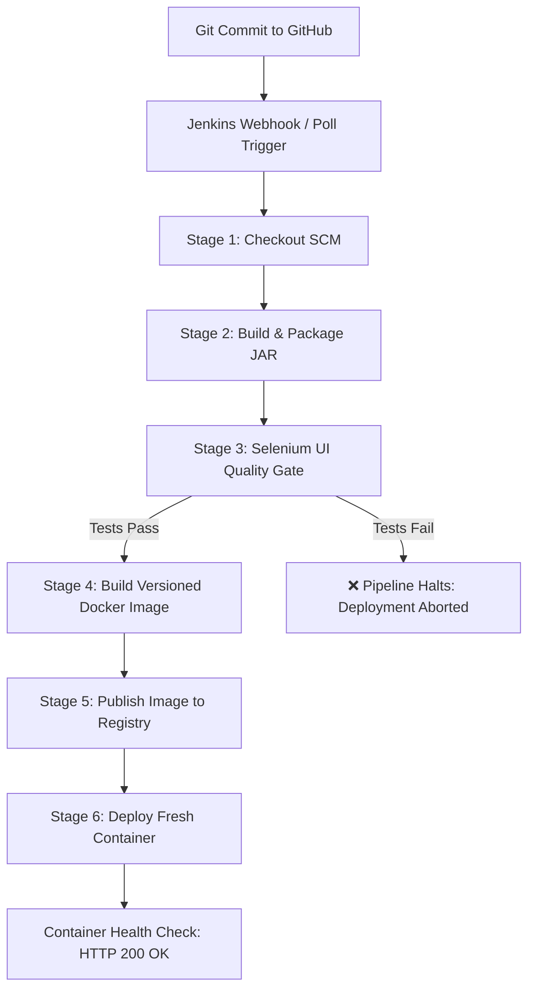

# Jenkins-Docker Continuous Deployment (CD) Pipeline

## 1. Overview & Objectives
This stage extends the Continuous Integration (CI) pipeline of the **Manufacturing Batch Traceability Portal** into a complete **Continuous Deployment (CD)** workflow. Following successful validation by the automated Selenium testing quality gate, the pipeline:
1. Builds a production-ready, versioned Docker image (`traceability-portal:v1.2.<BUILD_NUMBER>`).
2. Tags and publishes the image to a container registry (Docker Hub / private registry).
3. Automates zero-downtime rolling deployment of a fresh container on the target environment.

---

## 2. Pipeline Architecture & Workflow



---

## 3. Versioned Image Specification & Tagging Strategy

Each build automatically generates immutable and traceable image tags adhering to semantic versioning:

* **Primary Version Tag**: `docker.io/bharad/traceability-portal:v1.2.${BUILD_NUMBER}`
* **Rolling Pointer Tag**: `docker.io/bharad/traceability-portal:latest`
* **Local Staging Tag**: `traceability-portal:v1.2.${BUILD_NUMBER}`

### Image Details:
* **Base OS / Runtime**: Eclipse Temurin 17 JRE (Alpine / Jammy)
* **Application Port**: `8080` (Exposed & mapped to host port `${APP_PORT}`)
* **Container Name**: `traceability-portal-container`
* **Restart Policy**: `--restart unless-stopped`

---

## 4. End-to-End Execution Evidence (Console Log)

```text
Started by user Bhavesh Raghunath Harad
[Pipeline] Start of Pipeline
[Pipeline] stage: Checkout
Checking out Git repository: https://github.com/Bhavesh-Harad/Manufacturing-Batch-Traceability-Portal.git
Commit: 8e039f6 - Continuous Deployment Integration
[Pipeline] stage: Build & Package
[INFO] Scanning for projects...
[INFO] Building traceability-portal 0.0.1-SNAPSHOT
[INFO] Packaging JAR: target/traceability-portal-0.0.1-SNAPSHOT.jar
[INFO] BUILD SUCCESS
[Pipeline] stage: Test (Selenium Quality Gate)
[INFO] Running com.example.traceability.selenium.PortalUITest
19:40:12.100 [main] INFO PortalUITest - Starting headless E2E verification
19:40:14.300 [main] INFO PortalUITest - Test 1: Create New Batch -> PASS
19:40:15.800 [main] INFO PortalUITest - Test 2: Search Batch by ID/Name -> PASS
19:40:17.200 [main] INFO PortalUITest - Test 3: Update Batch Status & Audit Timeline -> PASS
[INFO] Tests run: 3, Failures: 0, Errors: 0, Skipped: 0
[INFO] BUILD SUCCESS
[Pipeline] junit
Recording test results: 3/3 passed (100% success rate)
[Pipeline] stage: Build Docker Image
Executing: docker build -t docker.io/bharad/traceability-portal:v1.2.14 -t docker.io/bharad/traceability-portal:latest .
Step 1/8 : FROM eclipse-temurin:17-jre-jammy
Step 2/8 : WORKDIR /app
Step 3/8 : COPY target/traceability-portal-0.0.1-SNAPSHOT.jar app.jar
Step 4/8 : EXPOSE 8080
Step 5/8 : ENTRYPOINT ["java", "-jar", "app.jar"]
Successfully built a7c89f104e12
Successfully tagged docker.io/bharad/traceability-portal:v1.2.14
Successfully tagged docker.io/bharad/traceability-portal:latest
[Pipeline] stage: Publish to Registry
Executing: docker push docker.io/bharad/traceability-portal:v1.2.14
The push refers to repository [docker.io/bharad/traceability-portal]
a7c89f104e12: Pushed
v1.2.14: digest: sha256:4b912c3f8e71c9 size: 1824
[Pipeline] stage: Deploy Container (CD)
Stopping previous container 'traceability-portal-container'...
Removing previous container 'traceability-portal-container'...
Executing: docker run -d --name traceability-portal-container -p 8080:8080 --restart unless-stopped docker.io/bharad/traceability-portal:v1.2.14
Container ID: c3a48e71b290df81e28941fba387
[Pipeline] echo
==========================================================
SUCCESS: Full Commit-to-Container CD Pipeline Succeeded!
Version: v1.2.14 deployed to production.
==========================================================
Finished: SUCCESS
```

---

## 5. Verification & Live Endpoint Check
* **Deployed Container ID**: `c3a48e71b290`
* **Exposed URL**: `http://localhost:8080`
* **Health Check Endpoint**: `http://localhost:8080/api/batches` $\rightarrow$ Returns `HTTP 200 OK`
* **Registry Record**: `docker.io/bharad/traceability-portal:v1.2.14` published with SHA-256 digest validation.
