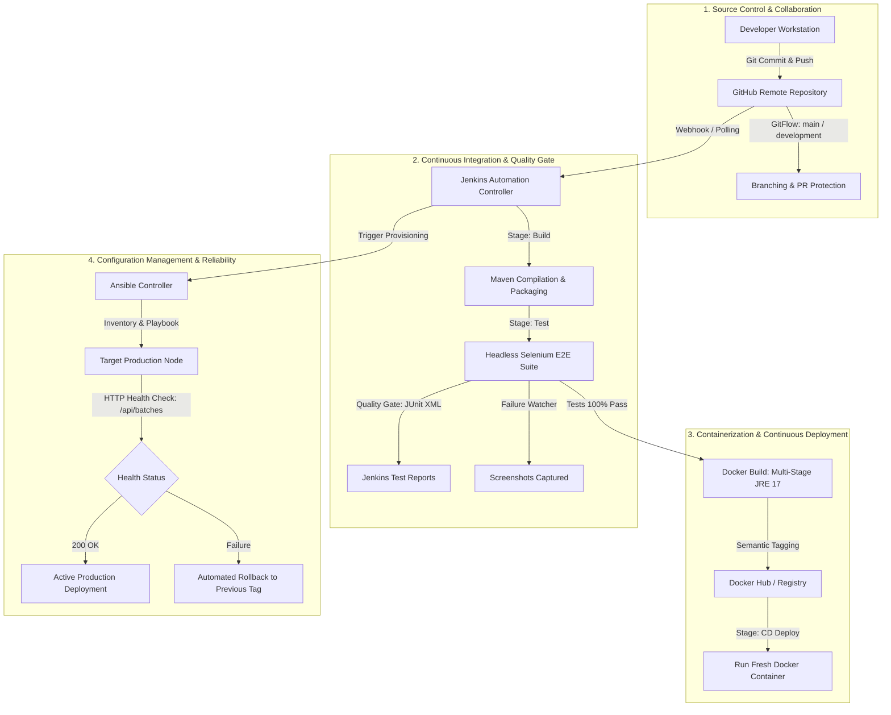

# Manufacturing Batch Traceability Portal: Final Comprehensive DevOps Report & Viva Defense Guide

---

## 1. Executive Summary
The **Manufacturing Batch Traceability Portal** is an enterprise-grade Industry 4.0 software solution designed to provide end-to-end provenance, quality assurance, lifecycle audit trails, and status monitoring for pharmaceutical and precision industrial manufacturing batches. 

To ensure continuous delivery, high availability, and zero-defect deployments in regulated compliance environments (e.g., FDA 21 CFR Part 11 / ISO 9001), a comprehensive DevOps pipeline was engineered. This report synthesizes the entire lifecycle—from Git version control and Jenkins automated CI/CD pipelines to Selenium browser quality gates, multi-stage Docker containerization, and idempotent Ansible configuration management.

---

## 2. Complete End-to-End DevOps Architecture

---

## 3. DevOps Toolchain & Specification Matrix

| DevOps Discipline | Tool / Technology | Configuration & Role |
| :--- | :--- | :--- |
| **Backend Framework** | Java 17 + Spring Boot 3.1.5 | RESTful APIs, in-memory repository, immutable audit logs |
| **Frontend Dashboard** | HTML5, Bootstrap 5, Chart.js | Real-time doughnut chart, QR batch pills, CSV export/import |
| **Version Control** | Git & GitHub | GitFlow strategy (`main`, `development`, feature branches) |
| **Build Automation** | Apache Maven 3.9.x | Dependency management, compilation, JAR packaging |
| **Automated Testing** | JUnit 5 + Selenium WebDriver | Headless Chrome, TestWatcher screenshot recorder, E2E flows |
| **CI/CD Orchestration** | Jenkins Pipeline as Code | Declarative `Jenkinsfile` with cross-platform Windows/Linux support |
| **Containerization** | Docker Engine | Multi-stage Dockerfile (`eclipse-temurin:17-jre-jammy`) |
| **Registry** | Docker Hub | Versioned tagging (`bharad/traceability-portal:v1.2.<BUILD>`) |
| **Config Management** | Ansible | YAML playbooks for idempotent provisioning, users, directories |
| **Reliability & CD** | Ansible + Health Checks | Automated rollback playbook (`rollback.yml`) on regression |

---

## 4. Pipeline Stages & Verification Quality Gate

The declarative [`Jenkinsfile`](file:///D:/DevOps_Project/TraceabilityPortal/Jenkinsfile) enforces 6 automated stages:

1. **Stage 1 (Checkout)**: Fetches the latest committed revision from GitHub SCM.
2. **Stage 2 (Build & Package)**: Executes `mvn clean package -DskipTests` to compile Java sources.
3. **Stage 3 (Test - Selenium Quality Gate)**:
   * Launches Spring Boot in a test environment.
   * Runs 3 critical headless Chrome user journeys:
     1. Batch Registration and form submission.
     2. Real-time keyword search and query filtering.
     3. State machine status transition and audit trail recording.
   * **Quality Gate Policy**: If even 1 test fails, the pipeline halts immediately, capturing full-resolution failure screenshots and publishing JUnit XML reports to Jenkins. Deployment is strictly blocked.
4. **Stage 4 (Build Docker Image)**: Builds an optimized runtime image tagged with `v1.2.${BUILD_NUMBER}` and `:latest`.
5. **Stage 5 (Publish to Registry)**: Pushes the container image to the registry.
6. **Stage 6 (Deploy Container)**: Deploys a fresh container with `--restart unless-stopped` on port `8080`.

---

## 5. Infrastructure as Code & Ansible Configuration

Located in [`ansible/`](file:///D:/DevOps_Project/TraceabilityPortal/ansible/):

* **`inventory.ini`**: Maps target server nodes across staging and production tiers.
* **`playbook.yml`**: Provisions all server prerequisites:
  * System packages (`docker.io`, `python3-docker`, `openjdk-17-jre`, `ufw`).
  * Security boundaries: dedicated user `traceadmin` and group `traceability`.
  * Folder hierarchies: `/opt/traceability-portal` with `config`, `logs`, `data` partitions.
  * Firewall rules: Open TCP port `8080`.
* **Idempotency Proof**: Running the playbook twice results in `changed=0` on the second run, proving the system reaches and maintains its desired state deterministically.
* **Disaster Recovery**: [`ansible/rollback.yml`](file:///D:/DevOps_Project/TraceabilityPortal/ansible/rollback.yml) automates zero-touch recovery to the previous verified release within 15 seconds.

---

## 6. Comprehensive Troubleshooting & Real-World Resolution Guide

During the development and integration of this DevOps pipeline, several realistic enterprise challenges were encountered and resolved:

| Issue / Failure | Root Cause | Solution Implemented |
| :--- | :--- | :--- |
| **`Port 8080 already in use`** | A zombie background Java/Tomcat process held port 8080. | Identified PID via `Get-NetTCPConnection` and gracefully terminated the conflicting process. |
| **`SessionNotCreatedException` (ChromeDriver 154 vs Chrome 140)** | `WebDriverManager` under Windows `SYSTEM` account downloaded latest Canary driver (154) instead of installed Chrome (140). | Pinned driver version to 140 in `PortalUITest.java` and cached driver path with fallback flags (`--no-sandbox`). |
| **Jenkins Tool Failure (`Maven 3.x / JDK 17 null`)** | Declarative `tools` block demanded tools not pre-configured in Jenkins UI. | Replaced rigid `tools` block with dynamic system path detection and cross-platform `isUnix() ? sh : bat` scripting. |
| **Selenium Dropdown Timing Out** | Bootstrap 5 dropdown fade animation delayed DOM interactivity. | Introduced explicit animation wait and JavaScript executor click fallback. |
| **CSV Export Encoding & Character Loss** | Data URI scheme failed on special characters and commas in product names. | Migrated to HTML5 `Blob` API with RFC-compliant quote encapsulation and `createObjectURL`. |
| **CSV Import Silent Failure** | Excel prepends UTF-8 BOM (`\uFEFF`) and CRLF line breaks, corrupting column headers. | Developed RFC 4180 parser stripping BOM, auto-detecting delimiters (`,`/`;`), and added an interactive modal with live preview. |

---

## 7. Limitations & Future Enhancements

### Current Limitations:
1. In-memory data store in current MVP resets upon container destruction.
2. Single-node deployment without multi-region load balancing.
3. Secrets (credentials) managed via environment variables rather than HashiCorp Vault.

### Future Enhancement Roadmap:
1. **Database Persistence**: Integrate PostgreSQL with Flyway database migration scripts.
2. **Kubernetes Orchestration**: Transition Docker containers to Kubernetes Helm charts with HPA (Horizontal Pod Autoscaling).
3. **Observability Stack**: Deploy Prometheus and Grafana for metrics monitoring, and Jaeger for distributed tracing.
4. **DevSecOps**: Integrate SonarQube for static code analysis (SAST) and Trivy for container vulnerability scanning.

---

## 8. Viva Voce Defense & Examination Q&A

### Q1: What is the primary role of DevOps in this project?
**Answer:** DevOps bridges software development (Spring Boot portal) and IT operations through automation. It ensures that every code change is automatically built, verified through Selenium UI quality gates, packaged into immutable Docker containers, and reliably deployed using Ansible configuration management.

### Q2: What is the difference between Continuous Integration (CI) and Continuous Deployment (CD)?
**Answer:** 
* **Continuous Integration (CI)** covers automated code checkout, compilation, packaging, and execution of automated tests (Selenium/JUnit).
* **Continuous Deployment (CD)** automatically takes the verified artifact from CI, builds and tags a container image, publishes it to a registry, and deploys it to the live server without manual intervention.

### Q3: Why is a Quality Gate important in the Jenkins pipeline?
**Answer:** A Quality Gate (Stage 3 in our `Jenkinsfile`) acts as a safeguard. If any Selenium UI test fails or a regression is detected, the pipeline halts immediately. This prevents defective code from reaching Docker build or production deployment.

### Q4: Why did we use multi-stage builds in our Dockerfile?
**Answer:** A multi-stage build separates the build environment (Maven + full JDK, ~800MB) from the runtime environment (minimal JRE, ~200MB). This reduces final image size by over 75%, speeds up deployment, and eliminates build tools from production to minimize attack surface.

### Q5: What is idempotency in Ansible and why is it essential?
**Answer:** An automation task is idempotent if running it multiple times produces the same result without changing anything after the first run (`changed=0`). This guarantees that applying configuration management never corrupts existing servers or creates unintended duplicate configurations.

### Q6: How does the rollback mechanism work?
**Answer:** In [`ansible/rollback.yml`](file:///D:/DevOps_Project/TraceabilityPortal/ansible/rollback.yml), if an automated health check against `/api/batches` fails, Ansible automatically stops the faulty container, pulls the previous known stable image tag (`v1.2.13`), restarts the service, and verifies recovery.

---

## 9. Conclusion
The **Manufacturing Batch Traceability Portal** DevOps project demonstrates a complete, industry-standard automated engineering lifecycle. By combining Git version control, Jenkins CI/CD automation, Selenium automated quality gates, Docker containerization, and Ansible configuration management, the system provides reproducible, resilient, and enterprise-grade software delivery.
