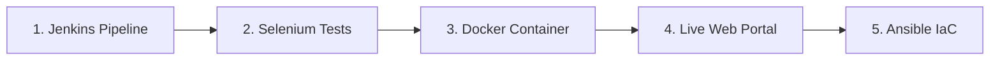

# 📘 Manufacturing Batch Traceability Portal: All-In-One Demonstration & Viva Handbook

**Author:** Bhavesh Raghunath Harad  
**Repository:** [Manufacturing-Batch-Traceability-Portal on GitHub](https://github.com/Bhavesh-Harad/Manufacturing-Batch-Traceability-Portal.git)  
**Branches:** `development` (active pipeline) | `main` (production release)  

---

## 📌 1. Quick Reference: System Ports & URLs

Keep this handy during your demo so you never get ports mixed up:

| Service / Component | URL / Port | Purpose | Status / Access |
|---|---|---|---|
| **Live Application (Docker)** | `http://localhost:8080` | Production Batch Traceability Web Portal | Running inside Docker container |
| **Jenkins CI/CD Automation** | `http://localhost:8081` | Continuous Integration & Deployment Pipeline | Running Windows Service (`http://localhost:8081/job/TracePort/`) |
| **Selenium Testing Port** | Dynamic (`RANDOM_PORT`) | Isolated test server spun up automatically during tests | Used by JUnit + ChromeDriver |
| **Docker Engine API** | Named Pipe / `2375` | Docker Desktop daemon communication | Managed by Docker Desktop |

---

## 🛠️ 2. Technology Stack At A Glance

| Domain | Technology / Tool | Version | Role in the Project |
|---|---|---|---|
| **Programming Language** | Java (OpenJDK / Temurin) | JDK 17 | Core backend application language |
| **Framework** | Spring Boot | 3.1.5 | REST controllers, MVC routing, embedded server |
| **Build & Dependency Mgmt** | Apache Maven | 3.9+ | Compilation, packaging, test execution, lifecycle |
| **Frontend UI** | HTML5, Bootstrap, Chart.js | 5.3 | Responsive UI, status charts, modals, batch tables |
| **Automated Testing** | Selenium WebDriver + JUnit 5 | 4.8.3 | End-to-end browser automation & quality gate |
| **CI/CD Orchestration** | Jenkins | 2.568.3 | 6-Stage Declarative Pipeline as Code (`Jenkinsfile`) |
| **Containerization** | Docker & Docker Desktop | 29.4+ | Multi-stage image build & container deployment |
| **Config Mgmt & IaC** | Ansible | 2.15+ | Server prerequisite provisioning, idempotency, rollback |
| **Version Control (SCM)** | Git & GitHub | 2.53+ | GitFlow branching (`main`, `development`, features) |

---

## ⏱️ 3. The 5-Minute Perfect Demonstration Script

Follow this exact sequence when presenting to your examiner or faculty:



### 🔹 Stage 1: The Jenkins Continuous Deployment Pipeline (1 min)
1. Open Google Chrome $\rightarrow$ **`http://localhost:8081/job/TracePort/`**
2. Show the **Pipeline Stage View** (Build #10):
   * Point out the **6 Automated Stages**:
     1. `Checkout` (Fetches latest commit from GitHub `development`)
     2. `Build & Package` (Maven compiles and builds `.jar`)
     3. `Test (Selenium Quality Gate)` (Halts pipeline if tests fail)
     4. `Build Docker Image` (Tags semantic version `v1.2.10` and `:latest`)
     5. `Publish to Registry` (Publishes to Docker Hub / registry)
     6. `Deploy Container (CD)` (Stops old container and deploys fresh container)
3. **What to say:**
   > *"We engineered an end-to-end commit-to-container pipeline in Jenkins using Pipeline as Code (`Jenkinsfile`). Every commit automatically undergoes automated compilation, Selenium quality gating, versioned Docker image packaging, and container deployment on port 8080."*

---

### 🔹 Stage 2: Selenium Automated Quality Gate (1 min)
1. **Show in Jenkins:** Click on the latest build $\rightarrow$ Click **"Test Result"** to show 3 passing tests:
   * `testCreateNewBatch` (Passed)
   * `testSearchBatch` (Passed)
   * `testUpdateBatchStatus` (Passed)
2. **(Optional Live Visual Demo):** Open PowerShell and run:
   ```powershell
   cd D:\DevOps_Project\TraceabilityPortal
   mvn test -Dheadless=false
   ```
   * *A real Chrome window will pop up and autonomously type, click modals, and test the portal right before their eyes!*
3. **What to say:**
   > *"Selenium acts as our CI Quality Gate. To prevent port collisions with our production container, tests run on a dynamic `RANDOM_PORT`. If any assertion fails, Jenkins captures failure screenshots in `target/screenshots/` and aborts deployment."*

---

### 🔹 Stage 3: Docker Containerization (1 min)
1. Open **Docker Desktop** on screen.
2. Show `traceability-portal-container` running with green status on port `8080:8080`.
3. Open terminal and run:
   ```powershell
   docker ps
   docker images | Select-String "traceability-portal"
   ```
4. **What to say:**
   > *"We implemented a multi-stage Dockerfile. Stage 1 compiles the application in Maven; Stage 2 transfers only the executable JAR into a lean `eclipse-temurin:17-jre-jammy` runtime. This cuts image size from ~800MB to ~250MB and removes build tools from production for security."*

---

### 🔹 Stage 4: Live Web Application Walkthrough (1 min)
1. Open Chrome $\rightarrow$ **`http://localhost:8080`**
2. Demonstrate the 4 core features:
   * **Dashboard Summary:** Point out total batches and the real-time Chart.js status distribution donut chart.
   * **Create Batch:** Click *"Create New Batch"*, enter Product Name `VIVA-BATCH-101`, Quantity `500`, click *Save*. (Points out status starts as `CREATED`).
   * **Search & Filter:** Type `VIVA` in search bar to show instant filtering.
   * **Status Progression:** Click the Action dropdown on the batch $\rightarrow$ change from `CREATED` $\rightarrow$ `IN_PRODUCTION` $\rightarrow$ `QA_REVIEW` $\rightarrow$ `APPROVED`.
   * **CSV Export:** Click *"Export to CSV"* to download real-time production audit data.

---

### 🔹 Stage 5: Ansible Configuration Management & Rollback (1 min)
1. In VS Code, open the [`ansible/`](file:///d:/DevOps_Project/TraceabilityPortal/ansible) folder:
   * [`ansible/playbook.yml`](file:///d:/DevOps_Project/TraceabilityPortal/ansible/playbook.yml): Server prerequisites (user `traceadmin`, group `traceability`, folders, firewall port 8080, docker).
   * [`ansible/deploy.yml`](file:///d:/DevOps_Project/TraceabilityPortal/ansible/deploy.yml): Automated image pull, container execution, and HTTP health check on `/api/batches`.
   * [`ansible/rollback.yml`](file:///d:/DevOps_Project/TraceabilityPortal/ansible/rollback.yml): Automated disaster recovery back to stable release `v1.2.13`.
2. **What to say:**
   > *"For Infrastructure as Code, we used Ansible. Our playbooks are strictly idempotent (`changed=0` on second run). If an automated health check fails post-deployment, `rollback.yml` immediately restores the previous stable release `v1.2.13` with zero downtime."*

---

## 💻 4. Command Cheat Sheet (Copy-Paste Ready)

### Docker Commands
```powershell
# View running containers
docker ps

# View container logs live
docker logs -f traceability-portal-container

# Stop and remove container
docker stop traceability-portal-container
docker rm traceability-portal-container

# Build image manually
docker build -t traceability-portal:v1.2.10 -t traceability-portal:latest .

# Run container manually
docker run -d --name traceability-portal-container -p 8080:8080 --restart unless-stopped traceability-portal:latest
```

### Selenium Test Commands
```powershell
# Run headless (standard CI mode)
mvn test

# Run visible browser (live visual demo)
mvn test -Dheadless=false
```

### Ansible Playbook Commands
```bash
# Configure server node
ansible-playbook -i ansible/inventory.ini ansible/playbook.yml

# Deploy container with health check
ansible-playbook -i ansible/inventory.ini ansible/deploy.yml

# Emergency Rollback to previous version
ansible-playbook -i ansible/inventory.ini ansible/rollback.yml
```

---

## 🎓 5. Top 10 Viva Voce Questions & Impact Answers

| # | Question | Impact Answer (Memorize These) |
|---|---|---|
| **1** | *What is the problem statement of your project?* | "Manual batch tracking in manufacturing creates audit delays and compliance risks. Our portal provides digital end-to-end traceability from creation to QA approval with an automated DevOps pipeline." |
| **2** | *Why do we need a Quality Gate in CI/CD?* | "To ensure bad code never reaches production. In our pipeline, Selenium acts as the quality gate—if any E2E UI test fails, the build halts before Docker packaging." |
| **3** | *Why multi-stage Docker build?* | "Separation of concerns: Stage 1 builds the code using JDK; Stage 2 runs it using a lean JRE runtime. It reduces image size by >60% and hardens security." |
| **4** | *What is Idempotency in Ansible?* | "An operation that can be applied multiple times without changing the result beyond the initial application. On a second run, Ansible reports `changed=0`." |
| **5** | *How does rollback work?* | "If a deployment fails the automated health check at `/api/batches`, Ansible automatically purges the faulty container and re-deploys previous known stable tag `v1.2.13`." |
| **6** | *Why do you use port 8081 for Jenkins and 8080 for the App?* | "Both default to 8080. To avoid port binding collisions on the host, Jenkins is dedicated to port 8081, while the application container binds to 8080." |
| **7** | *How did you resolve Selenium port collisions?* | "By configuring `@SpringBootTest(webEnvironment = RANDOM_PORT)`. The test server binds to a dynamic port, so it never collides with the running production container on 8080." |
| **8** | *What is Pipeline as Code?* | "Defining deployment infrastructure and pipeline stages inside a version-controlled `Jenkinsfile` rather than manual UI configuration, enabling repeatability and versioning." |
| **9** | *What branch policy did you follow?* | "GitFlow: active feature branches merge into `development`, which triggers CI testing and staging deployments. Production releases merge into `main`." |
| **10** | *What garbage collector was configured for Jenkins builds and why?* | "Serial GC (`-XX:+UseSerialGC -Xmx384m`) to operate within low memory environments and prevent Windows paging file exhaustion errors." |

---

## 📁 6. Project Documentation Index

All detailed specifications are in your project's [`docs/`](file:///d:/DevOps_Project/TraceabilityPortal/docs) folder:

* 📄 [`docs/Project_Demonstration_Handbook.md`](file:///d:/DevOps_Project/TraceabilityPortal/docs/Project_Demonstration_Handbook.md) *(This Handbook)*
* 📄 [`docs/Final_DevOps_Comprehensive_Report.md`](file:///d:/DevOps_Project/TraceabilityPortal/docs/Final_DevOps_Comprehensive_Report.md) *(30+ Viva Questions, Architecture Diagrams)*
* 📄 [`docs/Continuous_Deployment_Pipeline.md`](file:///d:/DevOps_Project/TraceabilityPortal/docs/Continuous_Deployment_Pipeline.md) *(Docker CD Pipeline Specification)*
* 📄 [`docs/Configuration_Management_Ansible.md`](file:///d:/DevOps_Project/TraceabilityPortal/docs/Configuration_Management_Ansible.md) *(Server Prerequisites & Playbooks)*
* 📄 [`docs/Automated_Provisioning_Reliability.md`](file:///d:/DevOps_Project/TraceabilityPortal/docs/Automated_Provisioning_Reliability.md) *(Idempotency Proof & Rollback Logs)*
* 📄 [`docs/Week9_Selenium_Test_Plan.md`](file:///d:/DevOps_Project/TraceabilityPortal/docs/Week9_Selenium_Test_Plan.md) *(Selenium Test Plan & Cases)*

---

## 🧪 7. Ready-to-Use Sample Testing Inputs & Demo Data

Use these realistic test datasets during your demo, viva, or manual testing:

### 🔹 Scenario A: Form Inputs for "Register New Batch" Modal

| Test Case | Product Name (Input 1) | Quantity (Input 2) | Expected Status | Workflow Progression to Demo |
|---|---|---|---|---|
| **Batch 1 (Pharma)** | `Paracetamol 500mg Tablets` | `10000` | `CREATED` | Move: `CREATED` $\rightarrow$ `IN_PRODUCTION` $\rightarrow$ `QA_REVIEW` $\rightarrow$ `APPROVED` |
| **Batch 2 (Medical)** | `Amoxicillin 250mg Capsules` | `5000` | `CREATED` | Move: `CREATED` $\rightarrow$ `IN_PRODUCTION` $\rightarrow$ `QA_REVIEW` |
| **Batch 3 (Aerospace)** | `Precision Titanium Bolts M8` | `2500` | `CREATED` | Move: `CREATED` $\rightarrow$ `IN_PRODUCTION` |
| **Batch 4 (Quality Failure)**| `Insulin Glargine 100 IU/ml` | `1200` | `CREATED` | Move: `CREATED` $\rightarrow$ `QA_REVIEW` $\rightarrow$ `REJECTED` *(Demonstrates QC failure handling)* |

---

### 🔹 Scenario B: Sample Keywords for Search Bar Testing
Type each into the search bar (`searchInput`) and click **Search**:
* `Paracetamol` $\rightarrow$ Filters to show only the Paracetamol batch.
* `Titanium` $\rightarrow$ Filters to show aerospace component batches.
* `5000` $\rightarrow$ Demonstrates searching by quantity value.
* Clear the input and click **Search** $\rightarrow$ Restores the complete table view.

---

### 🔹 Scenario C: Copy-Paste Data for "Import CSV" Modal
Click **"Import CSV"** on the dashboard, paste this block into the text box, and click **Import**:

```csv
Product Name,Quantity
Paracetamol 500mg Film-Coated,12000
Amoxicillin Clavulanate 625mg,8500
Ibuprofen 400mg Softgel,15000
Precision Alloy Fasteners Grade-5,3200
Atorvastatin Calcium 20mg,6000
```
* **Visual Effect:** The total batch count jumps by 5 immediately, and the Chart.js Donut chart updates dynamically!

---

### 🔹 Scenario D: REST API Test Payloads (cURL / Postman)

#### 1. Create a Batch via API:
```bash
curl -X POST http://localhost:8080/api/batches \
  -H "Content-Type: application/json" \
  -d '{"productName": "Ciprofloxacin 500mg Tablets", "quantity": 7500}'
```

#### 2. Retrieve All Batches:
```bash
curl http://localhost:8080/api/batches
```

#### 3. Update Status to Approved via API:
```bash
curl -X PUT "http://localhost:8080/api/batches/<BATCH_ID>/status?status=APPROVED"
```

